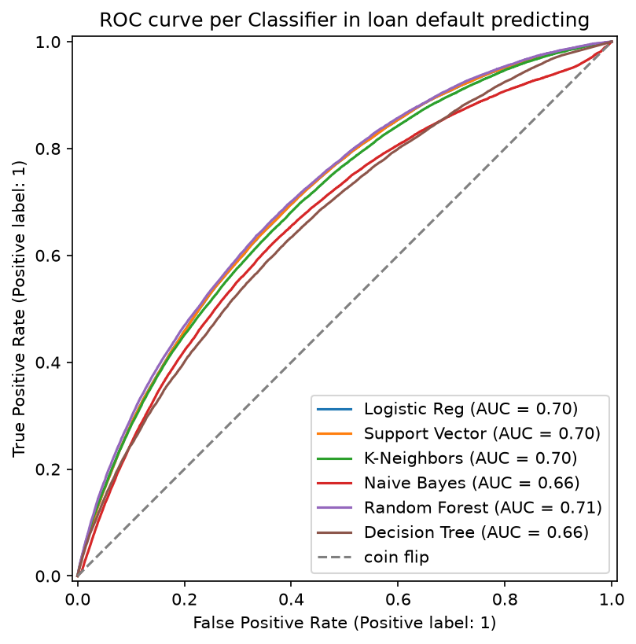

# 🕵️ Loan Default Detective

**Which loans default — and which model actually tells you that, versus just looking accurate?**

This project uses a public lending dataset (loan amount, interest rate, installment, debt-to-income, revolving utilization, open accounts, employment title and length, home ownership, annual income, loan purpose, and loan status) to run two parallel prediction tasks: a **classification problem** (will this loan default?) using Logistic Regression, Decision Trees, Random Forests, SVM, KNN, and Naive Bayes — and a **regression problem** (what interest rate will this loan get?) using Linear Regression. Every classifier is evaluated on the same shared metrics so they can be directly, honestly compared.

---



## 🎯 Project Questions

- Which classifier best predicts loan default, and by which metric (accuracy isn't enough here — defaults are rare)?
- Does a Random Forest actually beat a single Decision Tree, and by how much?
- Do SVM and KNN improve once features are properly scaled?
- Can Linear Regression predict interest rate meaningfully better than just guessing the mean?
- What does the precision/recall tradeoff actually mean for a lender deciding who to flag?

## Findings

1. **Accuracy is a trap:** predicting "no default" for every loan scores 80.5% accuracy and catches 0% of defaults. The best models score lower accuracy (about 66%) because they flag many more loans, and in return they catch 61–63% of real defaults.
2. **Random Forest wins, barely:** its ROC-AUC (0.709) is only 0.005 above Logistic Regression and SVM (both 0.704). On a single test set, the top three are a near tie.
3. **A forest clearly beats a single tree:** Random Forest vs Decision Tree gives ROC-AUC 0.709 vs 0.662 (+0.047), precision 0.316 vs 0.281, and recall 0.632 vs 0.615.
4. **The precision/recall tradeoff is steep:** the best model flags about 63% of real defaults, but only about 32% of the loans it flags actually default. That is roughly 1.6 times the 19.5% base rate, so the signal is real but modest. A lender would pick the cutoff by weighing the cost of a missed default against the cost of rejecting a good borrower.
5. **KNN ranks well but almost never flags:** its ROC-AUC (0.696) is close to the leaders, yet its recall at the default cutoff is only 0.019, because most of a loan's neighbors are non-defaults. It needs a lower threshold, not a different model.
6. **Data leakage nearly fooled the whole comparison:** an earlier run included the post-loan `recoveries` column (money recovered after a charge-off). It scored 0.84 ROC-AUC on its own, lifted every model to about 0.90, and put a sharp jump at the left edge of the ROC curves. Removing it brought the best AUC down to about 0.71, which is the honest number.

All numbers below are on the same held-out test set (203,154 loans, 19.5% defaults), using a stratified 80/20 split. The baseline predicts "no default" for every loan.

| Model                           | Accuracy | Precision | Recall  | F1    | ROC-AUC |
| ------------------------------- | -------- | --------- | ------- | ----- | ------- |
| Random Forest                   | 0.662    | 0.316     | 0.632   | 0.421 | 0.709   |
| Logistic Regression             | 0.664    | 0.316     | 0.619   | 0.418 | 0.704   |
| SVM                             | 0.667    | 0.317     | 0.612   | 0.418 | 0.704   |
| KNN                             | 0.806    | 0.541     | 0.019   | 0.037 | 0.696   |
| Naive Bayes                     | 0.711    | 0.329     | 0.462   | 0.384 | 0.664   |
| Decision Tree                   | 0.619    | 0.281     | 0.615   | 0.386 | 0.662   |
| _Baseline: always "no default"_ | _0.805_  | _n/a_     | _0.000_ | _n/a_ | _0.500_ |

---

## 📁 Repository Structure

```
loan-default-detective/
├── data/
│   ├── raw/                  # Untouched source lending dataset
│   └── processed/            # Cleaned, encoded, scaled, train/test-split data
│
├── notebooks/                 # Step-by-step, one notebook per phase
│   ├── 01_load_explore.ipynb
│   ├── 02_preprocess_split.ipynb
│   ├── 03_linear_logistic_regression.ipynb
│   ├── 04_trees_forests.ipynb
│   ├── 05_svm_knn_naive_bayes.ipynb
│   └── 06_model_comparison_evaluation.ipynb
│
├── src/                        # Reusable code, imported by notebooks/scripts (not copy-pasted)
│   ├── __init__.py
│   ├── data_load.py           # Load raw dataset
│   ├── preprocess.py           # Cleaning, encoding, scaling, train/test split
│   ├── train.py                 # One function per model, consistent train interface
│   └── evaluate.py              # Shared evaluation: accuracy, precision, recall, F1, ROC-AUC, RMSE
│
├── tests/                      # Unit tests for src/ functions
│   ├── __init__.py
│   └── test_preprocess.py
│
├── models/                     # Saved trained model files (.joblib), gitignored by default
│
├── outputs/
│   └── figures/                  # ROC curve comparison, feature importance plots, etc.
│
├── .gitignore
├── requirements.txt
└── README.md
```

---

## 🛠️ Setup

```bash
git clone https://github.com/hexsyro/loan-default-detective
cd loan-default-detective
python -m venv venv
source venv/bin/activate       # Windows: venv\Scripts\activate
pip install -r requirements.txt
```

---

## 🚀 Usage

0. **Get the raw data.** It is too large for the repo. Download it from [Kaggle](https://www.kaggle.com/datasets/wordsforthewise/lending-club) and save it as `data/raw/raw_loan_data.csv`.
1. **Load and clean the raw dataset** (reads `data/raw/`, writes `data/processed/loans_cleaned.csv`)
   ```bash
   python -m src.data_load
   ```
2. **Preprocess: clean, encode, scale, split** (fills `data/processed/`)
   ```bash
   python -m src.preprocess
   ```
3. **Explore in notebooks**, in order, starting with `notebooks/01_load_explore.ipynb`
   | Notebook | Open |
   |---|---|
   | 01 Load and explore | [](https://kaggle.com/kernels/welcome?src=https://github.com/hexsyro/loan-default-detective/blob/main/notebooks/01_load_explore.ipynb) |
   | 02 Preprocess and split | [](https://kaggle.com/kernels/welcome?src=https://github.com/hexsyro/loan-default-detective/blob/main/notebooks/02_preprocess_split.ipynb) |
   | 03 Linear and logistic regression | [](https://kaggle.com/kernels/welcome?src=https://github.com/hexsyro/loan-default-detective/blob/main/notebooks/03_linear_logistic_regression.ipynb) |
   | 04 Trees and forests | [](https://kaggle.com/kernels/welcome?src=https://github.com/hexsyro/loan-default-detective/blob/main/notebooks/04_trees_forests.ipynb) |
   | 05 SVM, KNN and Naive Bayes | [](https://kaggle.com/kernels/welcome?src=https://github.com/hexsyro/loan-default-detective/blob/main/notebooks/05_svm_knn_naive_bayes.ipynb) |
   | 06 Model comparison and evaluation | [](https://kaggle.com/kernels/welcome?src=https://github.com/hexsyro/loan-default-detective/blob/main/notebooks/06_model_comparison_evaluation.ipynb) |

4. **Train and evaluate the classifiers**

   ```bash
   python -m src.train
   python -m src.evaluate
   ```

5. Final comparison table and ROC curve get saved from `notebooks/06_model_comparison_evaluation.ipynb`

---

## 📊 Skills Practiced

| Skill                                                        | Where                             |
| ------------------------------------------------------------ | --------------------------------- |
| Linear regression                                            | `notebooks/03`                    |
| Logistic regression                                          | `notebooks/03`                    |
| Decision trees, random forests                               | `notebooks/04`                    |
| Support vector machines                                      | `notebooks/05`                    |
| k-nearest neighbors, Naive Bayes                             | `notebooks/05`                    |
| Model evaluation (accuracy, precision/recall, ROC-AUC, RMSE) | `src/evaluate.py`, `notebooks/06` |

---

## 📈 Sample Finding

> A model predicting 'no default' for every loan hits 80.5% accuracy — but 0% recall on actual defaults. Random Forest gives up about 14 points of accuracy (66.2%) for a recall of 0.63 on the default class, which is the metric that actually matters here.

---

## 📄 Data Sources

- Lending dataset: [All Lending Club loan data](https://www.kaggle.com/datasets/wordsforthewise/lending-club)

---

## 🔭 Possible Extensions

- Compare the `class_weight='balanced'` setting already used here against SMOTE, and see how much
  the comparison table shifts
- Tune hyperparameters (max_depth, n_estimators, k, C/gamma) with GridSearchCV
- Add a cost-sensitive analysis: assign a dollar cost to false negatives vs false positives
  and pick the "best" model by expected cost, not by a single metric
